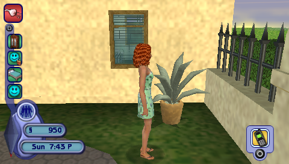
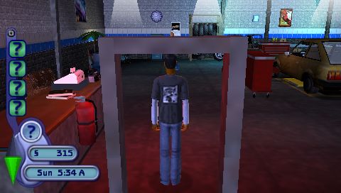

# The Sims 2 PSP Recomp

[](https://github.com/tokenbroker/sims2-psp-recomp/actions/workflows/build.yml)
[](https://github.com/tokenbroker/sims2-psp-recomp/releases/latest)
[](LICENSE)

**Return to Strangetown with modern display options, controller support and an in-game settings menu.**

An unofficial native PC port of **The Sims 2 for PSP (USA ULUS-10031 and Europe ULES-00211)**,
built by statically recompiling the game's Allegrex executable with
[PSPRecomp](https://github.com/jessicanataliagta/PSPRecomp).

**Windows playable preview; native Linux/Vulkan port in validation:** the game boots into live gameplay, saves and loads, and
includes modern display settings, audio playback, keyboard controls and SDL
controller support. It integrates with [RecompLauncher / RecompStore](https://recomplauncher.com/).

Fresh settings default to **1920 x 1080 output with 4x native rendering**.

Linux / Wayland / X11 build instructions and Steam Deck notes: [docs/LINUX.md](docs/LINUX.md).

This repository contains the recompiler, host runtime, configuration and build
tools. **The source tree contains no disc image, extracted game files, generated game
sources, saves or playable executable.** Windows prebuilt release archives include
compiled native game code, with no original disc files or assets. Supply your own
legally acquired supported USA or European ISO.

Input rebinding and mouse controls: [INPUT.md](docs/INPUT.md).
Benchmark methodology: [BENCHMARKS.md](docs/BENCHMARKS.md).
Hardware/compatibility limits: [HARDWARE-VALIDATION.md](docs/HARDWARE-VALIDATION.md).

**[Download](#download) | [Build guide](docs/BUILD.md) | [Settings](docs/SETTINGS.md) | [Linux / Steam Deck](docs/LINUX.md) | [Report a bug](https://github.com/tokenbroker/sims2-psp-recomp/issues)**

## Gameplay

| Paradise Place | Service station |
| --- | --- |
|  |  |

Actual local gameplay captures at the PSP framebuffer resolution (480 x 272).
These show the game image; output resolution and internal rendering scale are
configurable separately. See the [Vulkan playtest screenshots and fix notes](docs/PLAYTEST_SCREENSHOTS.md)
for the user-reported presentation issue.

## At a glance

| Feature | Available controls |
| --- | --- |
| Display | 1080p defaults, fullscreen modes, ultrawide aspects and custom resolutions |
| Graphics | 1x-8x internal scale, output-relative scaling and filtering |
| Performance | Presentation FPS cap, VSync and F2 frame-time overlay |
| Input | Keyboard, SDL controllers, rebinding and optional right-stick camera |
| In-game settings | F1 on keyboard, L3+R3 on a controller |
| Saves | Local encrypted save/load and launcher backup folder integration |
| Windows renderers | Direct3D 11; optional Vulkan in dual-backend builds |
| Linux | Native Vulkan with Wayland/X11; physical Steam Deck validation pending |

**Windows v0.4.3 includes prebuilt USA and European runtimes for both D3D11 and
Vulkan.** Select the supported ISO; the launcher chooses its region automatically. RecompLauncher verifies your ISO and prepares the
required local files; it no longer generates or compiles hundreds of units on
your machine. Disc verification and download time still apply.

## Download

[Latest release: v0.4.3](https://github.com/tokenbroker/sims2-psp-recomp/releases/latest)

| Platform | Download | First setup |
| --- | --- | --- |
| Windows 10/11 x64 | [Prebuilt Windows ZIP](https://github.com/tokenbroker/sims2-psp-recomp/releases/download/v0.4.3/Sims2PSP-win64-setup-0.4.3.zip) | Verify your supported ISO; no compiler, CMake or Python installation |
| Linux x64, Vulkan / Wayland / X11 | [Linux source installer](https://github.com/tokenbroker/sims2-psp-recomp/releases/download/v0.4.3/Sims2PSP-linux-x64-setup-0.4.3.tar.gz) | Compile locally using the documented dependencies |

**Windows:** extract the whole ZIP, import its folder into RecompLauncher and
select your supported USA or European ISO. Keep the ISO available during play. The Visual
C++ runtime and graphics driver must be installed; RecompLauncher checks runtime
prerequisites. First setup reads the ISO and extracts only the required local
files. Later Play starts the installed runtime directly. Settings and saves stay
in the per-user folder when the runtime is replaced.

**Linux:** this release still uses the source installer. It does not yet offer
the Windows no-compile setup experience. See [LINUX.md](docs/LINUX.md).

Source builds remain available on both platforms. See [BUILD.md](docs/BUILD.md)
and [prebuilt release packaging](docs/PREBUILT_RELEASES.md). Full display, audio
and input settings remain in F1; common options are also exposed by RecompLauncher.

## European languages

**ULES-00211** supports English, French, German, Spanish and Italian. Choose
**F1 > Display > Game language**, Save, then restart. The launcher page also has
separate **Europe:** settings. EU preferences use `settings-europe.ini`; USA
preferences and saves are preserved. The game uses its own regional save folder.

Both regions offer **Native and experimental 120/240 Hz engine timing**, using
verified regional timestep hooks. Both retain display scaling,
widescreen choices, controllers, audio settings and renderer switching.
See [regional support and validation](docs/REGIONAL_SUPPORT.md).

## Build and run

Windows 10/11 x64, Python 3.11+, CMake 3.21+, and Visual Studio 2022 with the
**Desktop development with C++** workload and Windows SDK are required.

```powershell
git clone https://github.com/tokenbroker/sims2-psp-recomp.git
cd sims2-psp-recomp
py -3.11 -m venv .venv
.venv\Scripts\python.exe -m pip install -r requirements-build.txt
.venv\Scripts\python.exe build.py "D:\Games\The Sims 2 USA.iso"
```

Setup verifies the supported disc/executable, downloads hash-pinned SDL3 and
FFmpeg development dependencies, generates the game code locally, compiles it,
and checks startup using an isolated memory stick. The first compile can take
a while; rerun the same command to reuse completed work.

The prepared game is placed in **`out/sims2-from-iso/install`**. In RecompLauncher,
use **Library > Bring Your Recomps > Pick a Folder > Not in the list: add it anyway**,
choose that folder, and select the same supported ISO. Play starts the game without a
console or diagnostic frame limit.

See [Build instructions](docs/BUILD.md) for prerequisites, direct launch, tests
and packaging. Generated outputs remain private and must not be committed or
redistributed.

## Display and graphics

Press **F1**, or click both controller sticks (**L3+R3**), for settings. The game pauses while the panel is open. Apply changes
for the session, or Save to persist them. **F2** toggles the performance overlay.

- Windowed, borderless and exclusive fullscreen; desktop, preset or custom sizes.
- Native PSP, automatic, 4:3, 16:9, 16:10, 21:9 and 32:9 aspect choices.
- Optional camera matching with proportional HUD/menu placement.
- Fixed 1x-8x internal resolution or 50%-200% output-relative render scaling.
- Anisotropic filtering, nearest/bilinear output filtering and VSync.
- Presentation FPS cap, frame-time graph and performance statistics.
- Experimental 120/240 Hz engine rates for USA and Europe.
- HDR controls, paper white and peak brightness, with SDR fallback.
- Master volume/mute, controller deadzone and optional right-stick camera.

**The presentation cap and engine rate are separate controls.** The latest source
includes experimental USA and European 120/240 Hz engine modes with a game-specific timestep fix.
Choose **F1 > Display > Engine frame rate**, Save, then restart. Use a matching or
unlimited presentation cap; VSync may limit output to the monitor's refresh rate.
Native remains the default. These modes have bounded timing/movement checks,
not a complete high-FPS playthrough. Unlimited applies to presentation only.
See [high-FPS investigation](docs/HIGH_FPS_RESEARCH.md). This setting is included starting with v0.2.5.
HDR maps the original SDR image into HDR output; Windows HDR must be enabled on
the current display. Windows defaults to **Direct3D 11**. Dual-backend installs
offer **F1 > Display > Graphics backend > Vulkan** (Save and restart).
Build with `--graphics BOTH` to install both runtimes; Vulkan uses the SDL3 shell.
See [Windows backend selection and validation](docs/WINDOWS_BACKENDS.md).
Native Linux Vulkan builds support Wayland and X11. See
[Linux validation and Steam Deck notes](docs/LINUX.md).

Details and hardware limitations: [Settings](docs/SETTINGS.md).

For integrated-GPU/handheld devices, try **F1 > Quality > Handheld / low load**.
Save and restart if changing the engine rate. The ROG Ally report remains under
investigation; this preset is not physical-device certification.

## Controls

Keyboard and a controller can be used together. Input is released when the game
loses focus, and the F1 panel consumes input while open.

| PSP control | Keyboard | Xbox / SDL gamepad |
| --- | --- | --- |
| Analog stick | I / J / K / L | Left stick |
| D-pad | Arrow keys | D-pad |
| Cross | X | A / South |
| Circle | Z | B / East |
| Square | A | X / West |
| Triangle | S | Y / North |
| L / R | Q / E | LB / RB |
| Start | Enter | Menu |
| Select | Backspace | View |

Right-stick horizontal camera mapping is optional in F1. Keyboard and controller
buttons follow PSP positions; the game's own prompts remain PSP prompts.

## Saves and settings

- Saves: `%LOCALAPPDATA%/Sims2PSPRecomp/memstick/PSP/SAVEDATA`
- Settings: `%LOCALAPPDATA%/Sims2PSPRecomp/settings.ini`
- Runtime log: `%LOCALAPPDATA%/Sims2PSPRecomp/logs/latest.log`

The launcher manifest declares the save folder for RecompLauncher backup. Save/load
is verified locally; interchange with original PSP hardware is not established.

## Status and bug reports

Opening movies, Create-A-Sim, the service-station introduction, arrival at
Paradise Place, initial estate interactions, Buy/Design operations and encrypted
save/load have been exercised. Development checks cover host timing, rendering, audio, input, save dialogs and
packaging, alongside focused gameplay smoke tests. A full playthrough is not a
release requirement; users can report later scene or hardware issues as they
encounter them.

See [Status and known limitations](docs/STATUS.md). Please use
the project issue tracker with the
build commit, reproduction steps, graphics settings and a redacted log. Do not
upload game files, generated code, saves, credentials or unredacted personal paths.

## Credits and license

- [PSPRecomp](https://github.com/jessicanataliagta/PSPRecomp): recompiler/framework;
  this tree includes local correctness and runtime changes.
- [Bigmission Recomp](https://github.com/jackgllghr/bigmission-recomp) and
  [Yakumo](https://github.com/TeamGDB/Yakumo): attributed MIT host/runtime work.
- [Dear ImGui](https://github.com/ocornut/imgui), [SDL3](https://libsdl.org/),
  [FFmpeg](https://ffmpeg.org/) and [tiny-AES-c](https://github.com/kokke/tiny-AES-c).
- The [abilliontokens Sims projects](https://github.com/abilliontokens) informed
  the F1 feature layout. Their Xbox-specific code and game patches are not used.

Project source uses the [MIT license](LICENSE), with third-party components under
their own licenses. See [Third-party notices](profiles/sims2/THIRD_PARTY.md) and
[Source provenance](docs/PROVENANCE.md).

This project is not affiliated with or endorsed by EA, Maxis or Sony.
