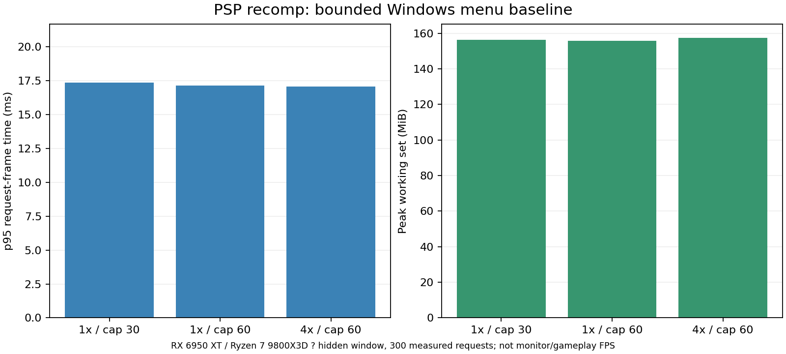

# Repeatable performance and timing checks

Run profiles/sims2/tools/benchmark.py against a locally generated sims2_probe.
It uses an empty isolated save, fresh boot, fixed settings, 600 warmup requests
and 300 measured requests by default. No game bytes or saved data enter its
aggregate JSON report. Do not compare different platforms/scenes as if they
were the same workload.

```sh
python3 profiles/sims2/tools/benchmark.py '/path/to/USA.iso' \
  --probe out/sims2-linux/build/profiles/sims2/sims2_probe \
  --boot out/sims2-linux/install/game/PSP_GAME/SYSDIR/BOOT.BIN \
  --output out/bench-run-1 --cases 1:30,1:60,4:60 --visible \
  --hardware-label 'GPU and driver, CPU, OS'
```

Windows uses python and its sims2_probe.exe path. A visible run presents a real
window; hidden/offscreen mode is explicitly labeled and cannot establish monitor
presentation performance. A virtual Wayland/X11 surface tests software paths,
not a handheld's FPS. Run real performance baselines with other compilation and
heavy work stopped. Keep raw logs, images and temporary saves private; only a
reviewed summary.json is intended for sharing.

Results include p50/p95/p99 request-frame times, requests per second, measured
guest/wall-time ratio, peak working set, rendered draws and presentation count.
The selected renderer adapter is read from the host log. Request FPS is not
necessarily presentation FPS: a 30 FPS cap can skip output while retaining native
game/sound timing. Hidden surfaces can present zero frames. Peak memory includes
the whole process and driver allocations visible in its working set; it is not
VRAM usage. An unpaced run measures throughput, not real-time correctness.

Treat the present fresh-boot scenario as a startup/menu baseline. Publish separate
scripted walking, camera and object-placement scenarios when their inputs/saves
can be reproduced. Avoid a single FPS figure that conceals loading, movie, menu
and gameplay differences. The benchmark itself has tests for stalls, percentile
calculation, warmup handling and clock drift.

## PSP timing investigation

The native virtual display clock is 60000/1001 Hz (~59.94), defined in
host/kernel/guest_clock.hpp. Display waits, callbacks, controller sampling and
scheduling use this clock; changing it globally would affect more than graphics.
The baseline 900-request run reached 27,510,816 guest microseconds and rendered
40,684 draws. Timing instrumentation observed 896 wait-start-CB calls returning
to 0x08939000 and 240 returning to 0x0897C0F0. The first follows framebuffer
submission in the render loop; the second is a separate startup path. Those
addresses identify the supported USA build; no guest code is distributed.

SIMS2_TIMING_TRACE writes an opt-in caller/count report without changing timing.
The build option SIMS2_TIMING_RESEARCH adds a developer-only bounded experiment:
SIMS2_EXPERIMENTAL_RENDER_HZ=60..240 changes only the first observed caller's wait.
It requires an explicit temporary memory stick, a timing trace and a frame limit.
Normal builds reject this variable; ISO setup explicitly turns research off.
This is not an F1 engine unlock or a supported feature. More framebuffer requests
alone do not establish correct animation, camera, physics, audio or save behavior.
Results and the decision to keep production timing native are recorded below.

## Recorded experiment result

In the fresh-boot test, shortening the main render wait to a requested 120 Hz
produced 900 framebuffer requests and the same 40,684 draws. Total guest time
changed from 27,510,816 to 27,460,766 microseconds. In **both** runs the final
300 menu requests still occurred at 59.94006 per guest second, with 16,683/16,684
microsecond intervals. The secondary startup path remained at 240 waits. Thus
this single wait change did not unlock the steady-state menu cadence. Additional
synchronization must be investigated before any engine-FPS claim. The observation
does not identify every remaining gate or prove gameplay behavior at higher rates.
See data/timing-experiment.json. Software-driver runs overlapped compilation;
their wall-time FPS is deliberately not published as a hardware benchmark.

## Windows hardware baseline

Subsequent consistent-clock experiments reached higher render cadence but
accelerated gameplay. See [high-FPS research](HIGH_FPS_RESEARCH.md) for the
matched-time captures and the distinction from the single-wait experiment above.

The first recorded baseline used an RX 6950 XT (selected by D3D11), Ryzen 7
9800X3D and AMD driver 32.0.21045.16010. Each fresh run requested 1920x1080,
VSync off, a hidden window, 900 total requests and 600 warmup requests. No other
compiler workload was running. The measured 300-request menu portion remained
near 60 requests/s in all three configurations; guest/wall ratios were about
1.001. No measured request exceeded 33.333 ms. These figures do not establish
visible display FPS, later gameplay performance or performance on other GPUs.



The complete reviewed aggregates are in data/windows-menu-baseline.json. This
initial development baseline did not capture a runtime hash; future runs record
the executable SHA-256, source revision, dirty state and UTC timestamp. At 4x
and a 60 cap, p95 was 17.078 ms, p99 17.272 ms and peak working set 157.25 MiB.
These are process/request measurements; they are not GPU VRAM or a 1% low monitor
FPS claim. The 30 cap reduces presentation calls while preserving simulation
requests; presentation counts in the JSON cover the complete startup run.
