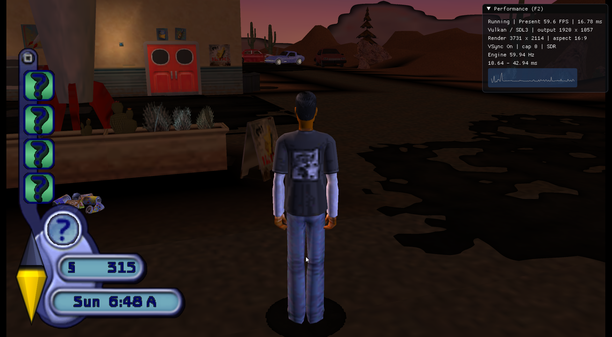
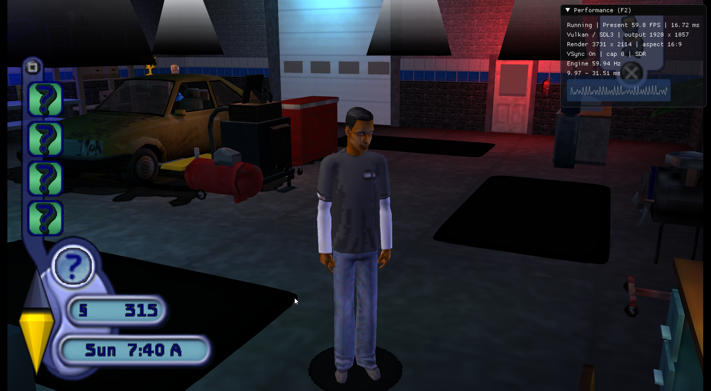

# Vulkan playtest screenshots

These player-provided Windows/Radeon RX 6950 XT screenshots document the
**pre-fix Vulkan presentation bug**. The black ground patches and dark light
cones are defects, rather than the intended appearance of the game. These are
historical reports, not screenshots of the corrected output.

## Outside the service station - before the fix

## Inside the garage - before the fix

The fix makes the displayed GPU image opaque while preserving the PSP
framebuffer alpha used by game blending. GPU readback regression checks cover
opacity, color preservation, render scales and destination-alpha blending.
See [the diagnosis and regression coverage](VULKAN_PRESENTATION.md) and
[the separate Vulkan performance improvements](VULKAN_PERFORMANCE.md).

Both fixes are in the current source; published v0.2.4 installers predate them.
The screenshots contain game imagery and the performance overlay only; image
metadata was removed before publication. No save files or game binaries are included.

[Back to the project](../README.md)
